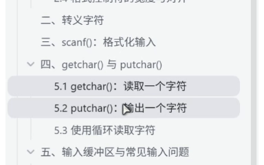

# Quick Rename

在 Obsidian **右侧原生「大纲」面板**里，双击任意标题条目，直接在该条目上进入行内编辑；回车生效，Esc 取消。重命名会同步更新全库中指向该标题的内部链接（等价于原生「Rename this heading」的结果）。

---



---

### 1. 如何使用

1. 打开一条笔记，点右侧边栏的大纲图标（或 `Ctrl+P` → `Outline`）显示原生大纲面板。
2. **双击**某个标题条目 → 该条目文字变成输入框，并自动全选标题文字。
3. 输入新标题：
   - `Enter` 提交；
   - `Esc` 取消；
   - 点击别处 = 提交（可在设置里改成「视为取消」）。
4. 提交后：源文件中的标题行被改写，全库指向它的链接同步更新，右下角会提示「已重命名标题「…」，同步更新 N 处链接」。

> **单击行为保持不变**：单击仍然是原生的大纲跳转，并且**没有任何延迟**——第一次点击直接交给 Obsidian 处理，编辑器立刻滚动到该标题；只有紧接着的第二次点击（间隔小于「双击判定窗口」，默认 300 ms）才会取消跳转并在原地进入编辑。

---

## 2. 功能细节

| 行为 | 说明 |
| --- | --- |
| 触发范围 | 仅 `.workspace-leaf-content[data-type="outline"]`，且默认只响应右侧边栏（`.mod-right-split`）中的大纲；左侧文件树、编辑区、其他面板不受影响 |
| 编辑控件 | 行内 `<input>`，插入在原条目的 `.tree-item-inner` 之后，样式沿用主题变量（`--background-modifier-form-field`、`--interactive-accent` 等） |
| 折叠箭头 | 点击箭头仍然是原生的展开/折叠，不会进入编辑 |
| 空标题 | 拒绝提交并提示「标题不能为空」 |
| 重名标题 | 同一文件内已存在同名标题（忽略大小写与多余空格）时拒绝提交，避免 `[[#标题]]` 指向歧义 |
| 输入清洗 | 自动去掉误粘贴的前导 `#`（如 `### 标题`）和会被 Markdown 当成闭合标记的尾部 ` #`；`C#` 这类不受影响 |
| 保留格式 | 改写标题行时保留 `#` 层级、行首缩进、闭合的 `###`、以及 CRLF 换行 |
| 实时生效 | 提交后立即回到大纲，**无需刷新**即可再次双击同一标题继续改名；标题内容与链接同步写入磁盘，编辑器里同一帧就能看到新标题 |
| 中文输入法 | 输入法候选框的回车（`isComposing` / `keyCode 229`）不会被当作提交 |
| 大纲搜索过滤 | 通过视图内部的 `cachedHeadingDom` 把 DOM 行映射回标题对象，即使大纲过滤了部分条目也不会错配 |

### 支持同步的链接形式

```
[[笔记#旧标题]]                  → [[笔记#新标题]]
[[#旧标题]]                      → [[#新标题]]           （同文件内引用）
[[笔记#旧标题|显示文本]]          → [[笔记#新标题|显示文本]] （别名保留）
![[笔记#旧标题]]                  → ![[笔记#新标题]]
[文字](笔记.md#旧标题)            → [文字](笔记.md#新标题)
[文字](笔记.md#旧%20标题)         → [文字](笔记.md#新%20标题) （原有编码风格保留）
```

匹配标题时忽略大小写与首尾/重复空格，并会尝试 URL 解码（`%20` 等），与 Obsidian 的链接解析规则一致。

**不会**被改动：块引用 `[[笔记#^blockid]]`、标题内的 `#`（如 `C#`）、代码块中的字符串、Canvas / 白板内的链接、Dataview 内联查询里的文本。

---

## 3. 更新日志

### 1.1.0

- **修复**：重命名一个标题后，若不刷新大纲就直接再次双击它，会提示「目标标题已被修改」，或链接没有被同步。现在每次进入编辑都从磁盘读取最新内容来定位标题，并用「最近重命名补丁表」跨过 metadata 缓存的滞后，因此可以**连续重命名、随时修改**，无需刷新。
- **修复**：链接同步不再依赖缓存里的字符偏移，改为逐个候选文件扫描原文匹配；缓存滞后时也不会漏改链接。
- **优化**：单击大纲标题的跳转**不再有任何延迟**（原来固定延迟 250 ms）。现在是「第一次点击直接放行 = 原生跳转，第二次点击才拦截 = 进入编辑」。
- **变更**：设置项「单击跳转延迟」改为「双击判定窗口」，默认 300 ms，范围 150–500 ms。
- 不再修改 metadata 缓存里的标题对象，只乐观更新大纲行的文字。

### 1.0.0

- 首个版本：右侧原生大纲双击标题 → 行内重命名，同步全库 `#标题` 链接。

